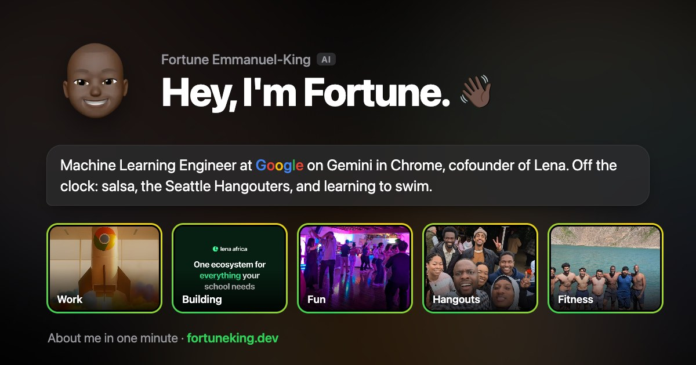
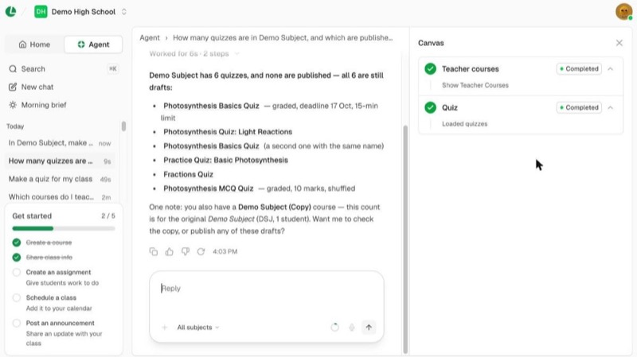
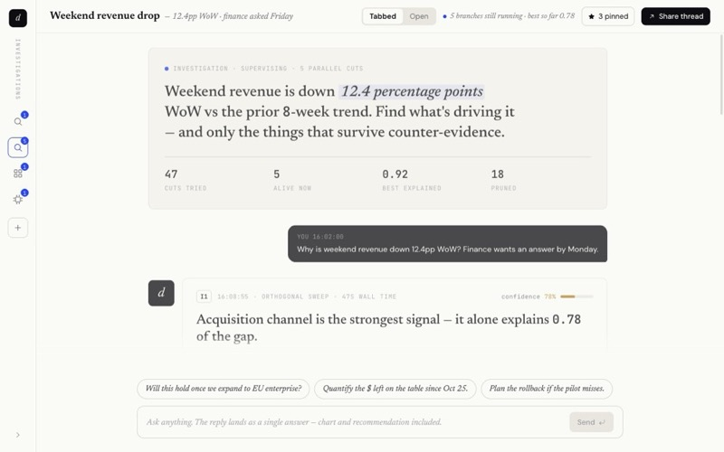
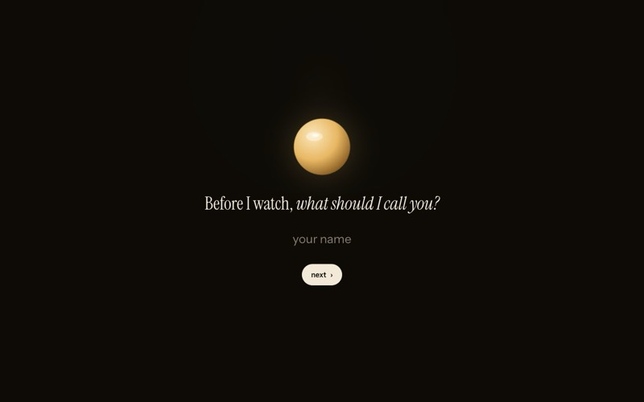
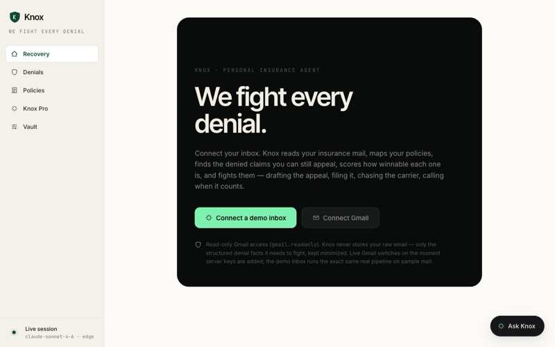
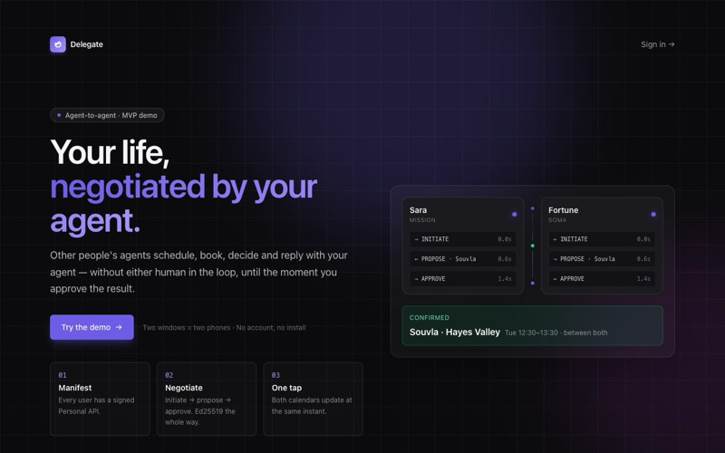
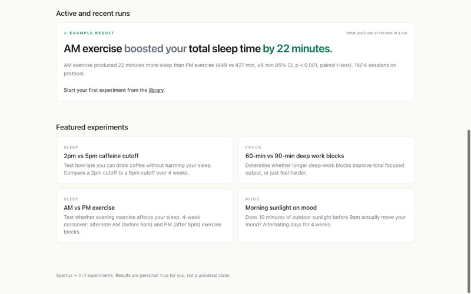
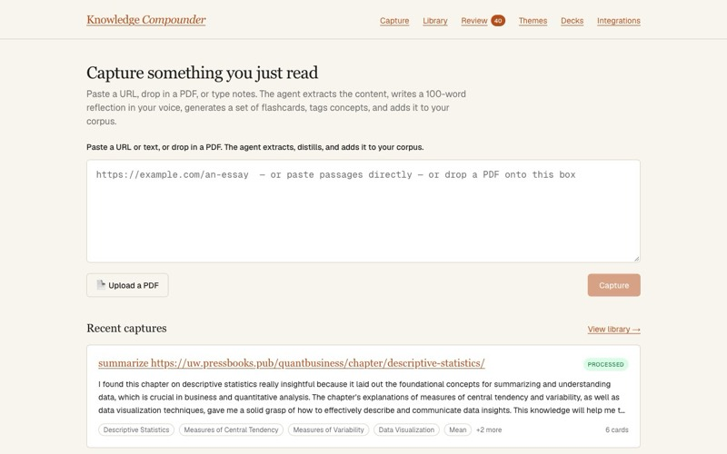
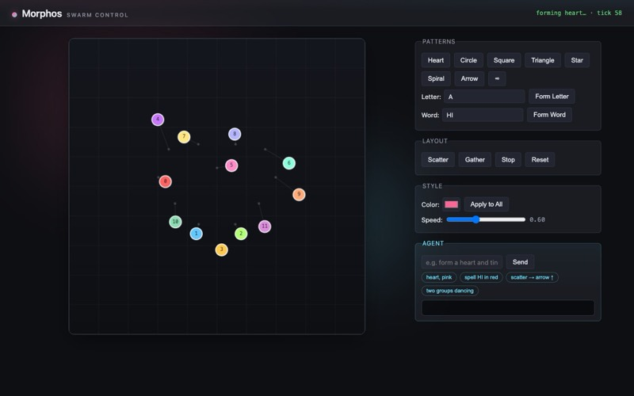

I'm a machine learning engineer on **Chrome AI at Google**, where we work on Gemini in Chrome as it starts doing things on the web for you. Before that, two years on Google Colab, on its Gemini agent. I'm also a cofounder
of **[Lena](https://lena.africa)**, software that runs schools around the world.

**The fastest way to know me is [fortuneking.dev](https://fortuneking.dev)**: one
conversation with me. Tap through, or ask anything.

## What we're building

Lena runs in schools today. Everything else here is live and free to try, and none
asks you for an API key.

<table>
<tr>
<td width="50%" valign="top">
 
<b><a href="https://lena.africa">Lena</a></b>: we're building an agent into it. A
teacher types one sentence, and it builds the quiz, publishes it and tells the class,
each step a card you can check.
</td>
<td width="50%" valign="top">
 
<b><a href="https://dsm.fortuneking.dev">DSM</a></b>: ask why a number moved. It runs
real Python and keeps only the findings that survive counter-evidence.
</td>
</tr>
<tr>
<td width="50%" valign="top">
 
<b><a href="https://maestro.fortuneking.dev">Maestro</a></b>: an AI tutor that
watches you practice any skill, by camera and voice.
</td>
<td width="50%" valign="top">
 
<b><a href="https://knox.fortuneking.dev">Knox</a></b>: an agent that fights denied
insurance claims.
</td>
</tr>
<tr>
<td width="50%" valign="top">
 
<b><a href="https://delegate.fortuneking.dev">Delegate</a></b>: other people's agents
negotiate plans with yours.
</td>
<td width="50%" valign="top">
 
<b><a href="https://apertus.fortuneking.dev">Apertus</a></b>: turn a question about
yourself into a clean experiment on yourself.
</td>
</tr>
<tr>
<td width="50%" valign="top">
 
<b><a href="https://knowledge-compounder.fortuneking.dev">Knowledge
Compounder</a></b>: read something, and it turns into flashcards, notes and drafts.
</td>
<td width="50%" valign="top">
 
<b><a href="https://morphos.fortuneking.dev">Morphos</a></b>: tell a robot swarm
"make a heart" and watch it form, in simulation.
</td>
</tr>
</table>

They all run on **[fortune-llm](https://github.com/4tunekvng/fortune-llm)**, an
open-source gateway that speaks the Anthropic API, tries free model providers first
and pays only as a last resort. That is why a stranger can use any of them for free.

## Research

- **Small, pre-registered agent experiments.** A reflective context-engineering
  agent beat standard retrieval-augmented generation by 21 points on HotpotQA (100
  paired questions, p = 0.002). Then we found bugs in our own graders and threw out
  a result we liked.
- **Teaching, not telling.** A reinforcement learning environment where a model
  writes a lesson for a simulated student, and the reward is whether the student can
  then solve problems it couldn't before. One hour every Friday.
- **Where this goes.** Agents are the day job. World models are the dream: AI that
  learns how a world works and can run it forward in its head.

## Path

Google, Chrome AI · Google, Colab AI · Amazon · Fermilab (dark-matter detector) ·
Northwestern (BS in Electrical Engineering and MS in AI, in four years)

[Résumé](https://fortuneking.dev/resume.pdf) ·
[LinkedIn](https://www.linkedin.com/in/fortuneking) ·
[fortuneking.dev](https://fortuneking.dev)
